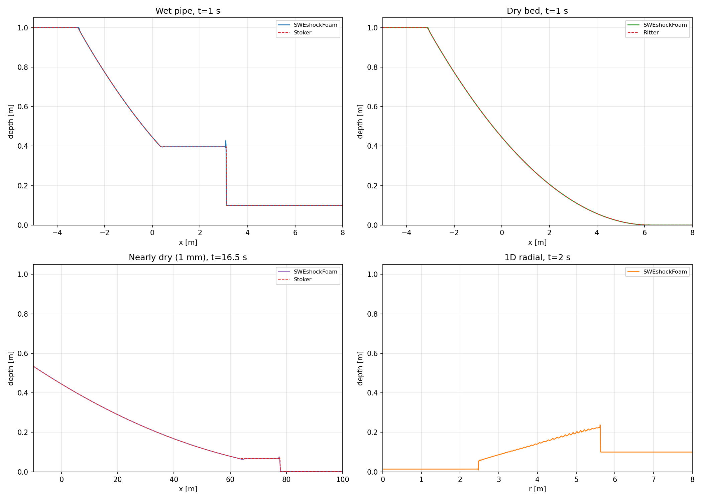
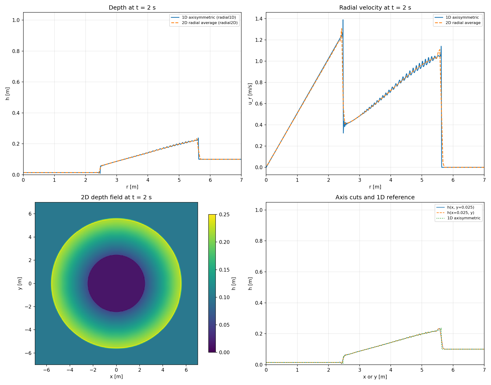

# SWEshockFoam

2D shallow-water solver written as an OpenFOAM application.  The same
face loop runs on a 1D strip (two empty directions) and on a 2D mesh
(one empty direction).  `radial true` in `system/controlDict` selects the
1D r-weighted axisymmetric form.

## Equations

Cartesian, flat bed:

```
d_t h     + div(h U)               = 0
d_t (h U) + div(h U U + g h^2/2 I) = 0
```

Axisymmetric 1D (`radial true`), r-weighted:

```
d_t (r h)   + d_r (r h u)                 = 0
d_t (r h u) + d_r (r h u^2 + g/2 r h^2)   = g/2 h^2
```

The axis is at `x = 0`; the radial strip runs along `x`.  The
`r`-weighting removes the `1/r` singularity and the axis face has
`r_f = 0`, so its flux is zero automatically.

## Numerics

- **Face loop** over `mesh.owner()` / `mesh.neighbour()`; the flux is
  stored in the owner -> neighbour direction and applied with the correct
  sign to both cells.
- **HLL** for the 1D strip, **HLLC** for 2D (`riemann auto`); the
  tangential velocity is carried through the HLLC contact.  At a
  wet/dry face the solver falls back to HLL.
- **MUSCL** reconstruction with a **Barth-Jespersen** limiter in
  primitive variables (`h`, `U`).  A face next to a cell below
  `dryRecon` (default `1e-4 m`) falls back to first order.
- **Forward Euler**, CFL time step.  The default is `cfl 0.1`: at 0.4 the
  forward-Euler + MUSCL combination is unstable (see below).
- **Dry floor** `dMin = 1e-10 m`, **dry tolerance** `dryTol = 1e-8 m`;
  `U = 0` on dry cells.
- **Walls / symmetry** use the exact wall flux `F = (0, p_wall n)` with
  `p_wall = g h^2/2`; the mirror-state Riemann trick adds spurious
  momentum and is not used.
- **Boundary faces** use the full face area; zero-gradient patches are
  transmissive (`ghost = interior`).

Runtime switches in `system/controlDict` (all optional):

| Key | Default | Meaning |
|---|---|---|
| `radial` | `false` | 1D r-weighted axisymmetric form |
| `cfl` | `0.1` | CFL number |
| `maxDeltaT` | `0.01` | time-step cap |
| `muscl` | `true` | MUSCL on/off (first-order diagnostic) |
| `riemann` | `auto` | `auto`, `hll`, `hllc` |
| `dryTol` | `1e-8` | dry tolerance |
| `dryRecon` | `1e-4` | first-order fallback depth |

## What was broken, and what was fixed

1. **Neighbour flux sign.**  In the cell update the flux was added with
   `+F*magSf` for every cell face.  `Sf` points from owner to neighbour,
   so for a neighbour cell the outward normal is `-Sf`; the flux must be
   subtracted.  The wet pipe blew up exponentially at `t ~ 0.006`
   (`dmax ~ 1e122`) because of this.  Fixed with
   `sgn = (own[facei] == i) ? +1 : -1`.
2. **Boundary face areas.**  `mesh.magSf()` is a `surfaceScalarField`;
   converting it to a plain `scalarField` gives **only the internal
   faces**.  The cell update and the CFL loop indexed it with boundary
   face labels, i.e. read out of range.  The boundary cells saw garbage
   areas and developed spikes even in first order.  Fixed by building a
   full `magSf` array from the internal faces and `p.magSf()`.
3. **Radial switch was ignored.**  `radial true` was never read, so
   `radial1D` computed a Cartesian dam break.  Implemented `rCell`,
   `rFace`, the `r`-weighted fluxes and the geometric source `g/2 h^2`.
4. **Wall/symmetry flux.**  A mirrored state in HLL/HLLC gives
   `F_n = 2h u^2 + h u c`, not `p_wall n`.  Fixed with the exact wall
   flux; the 2D radial tank is now a proper closed tank.
5. **HLLC was defined but unused.**  2D used HLL.  Now 2D uses HLLC
   (`riemann auto`), while the 1D strip keeps the validated HLL.
6. **Dry gradients and the drying front.**  `flux/depth` was `0/0` on
   dry boundaries; replaced by `flux/max(depth, dMin)`.  A dry-aware
   first-order fallback and CFL 0.1 keep the dry front monotone.
7. **CFL.**  Forward Euler + MUSCL is unstable at CFL 0.4 on these
   cases: the wet run overshoots to `hmax ~ 1.008` and the dry run forms
   a spurious blob at the front.  CFL 0.1 is stable and accurate; CFL 0.2
   is clean for the wet/nearly-dry cases but not for the dry front.

The working source is `SWEshockFoam.C`; the pre-fix development copy is
not part of the repository.

## Cases

| Case | Mesh | Initial state | End time | Flux |
|---|---|---|---|---|
| `pipe1D` | 2000 x 1 x 1, `x in [-10,10]` | wet 10:1 | 1 s | HLL |
| `pipe1D_dry` | same | `h_R = 0` | 1 s | HLL |
| `pipe1D_nearly` | 2000 x 1 x 1, `x in [-160,160]` | `h_R = 1 mm` | 16.5 s | HLL |
| `radial1D` | 2000 x 1 x 1, `r in [0,10]` | `h_L = 1`, `h_R = 0.1`, `R0 = 1` | 2 s | HLL, radial |
| `radial2D` | 400 x 400 x 1, `[-10,10]^2` | `h_L = 1`, `h_R = 0.1`, `R0 = 1` | 2 s | HLLC |

All cases use `blockMesh` + `setFields`; `radial2D` reuses the
`cylinderToCell` setup of `../radialDamBreak`.

## Results

1D Cartesian, `pipe1D` and `pipe1D_nearly` against Stoker; `pipe1D_dry`
against Ritter:

| Case | Quantity | Reference | SWEshockFoam | Error |
|---|---|---|---|---|
| wet, t=1 | `h_2` | 0.396175 | 0.396180 | +0.001 % |
| wet, t=1 | `u_2` | 2.321355 | 2.321479 | +0.005 % |
| wet, t=1 | `c_s` | 3.105134 | 3.103032 | в€’0.068 % |
| nearly dry, t=16.5 | `h_2` | 0.066830 | 0.066770 | в€’0.090 % |
| nearly dry, t=16.5 | `u_2` | 4.644801 | 4.647626 | +0.061 % |
| nearly dry, t=16.5 | `c_s` | 4.715359 | 4.709773 | в€’0.118 % |
| dry, t=1 | front (`2 c_0`) | 6.264184 | 6.625 (`h > 1e-6`) | +5.8 % |

The dry front is smeared by the HLL diffusion; its `h > 1e-6` crossing
overestimates the front.  The profile follows Ritter, the depth stays
positive (`h_min = 1e-10`), `h_max = 1.000034`, `u_max = 6.397`, and the
mass is conserved to roundoff.  The wet and nearly-dry plateau/shock
values are essentially exact.

1D axisymmetric and 2D radial at `t = 2 s`:

| Quantity | `radial1D` | `radial2D` |
|---|---|---|
| `h_center` | 0.013742 | 0.014110 |
| `h_max` | 0.238120 | 0.233014 (at `r = 5.575`) |
| `r_front` | 5.6275 | 5.6250 |
| `h_front` | 0.157476 | 0.160661 |
| `u_max` | 1.38928 | 1.30635 |
| `h_min` | 0.008682 | 0.004379 |

The 2D case is perfectly axisymmetric on the 400 x 400 mesh:
`max|h(x,y)-h(-x,y)| = max|h(x,y)-h(x,-y)| = max|h(x,y)-h(y,x)| = 0`
to machine precision.  Its mass is conserved to `1.2e-10` relative.
The 1D/2D differences are the expected resolution difference: the 1D
radial case has `dr = 5 mm`, the 2D case `dx = 50 mm` across the dam.





The 2D depth field is a clean circular bore; the 1D and 2D radial
profiles almost coincide.

## Caveats

- **CFL 0.1.**  This is the price of forward Euler + MUSCL on the drying
  front.  The solver is robust but slower than a CFL-0.4 scheme.
- **Dry front.**  HLL is diffusive; the `h > 1e-6` front metric is ~6 %
  ahead.  Positivity and mass conservation are solid.
- **Radial sawtooth.**  A small residual oscillation remains in `u_r` on
  the outer plateau (also visible in the 2D average).  The geometric
  source is well balanced for a lake at rest and the 2D symmetry is
  exact, but a smoother limiter / a fully well-balanced radial source is
  still future work.
- **2D cost.**  The 400 x 400 run takes roughly 10-15 min on the WSL
  machine and writes 20 ascii time directories (`writeInterval 0.1`).
- The solver is flat-bed only; `h0` is ignored.  HLLC is used for wet
  2D faces; a wet/dry face falls back to HLL.

## Build and run

```sh
cd solvers/SWEshockFoam
wmake

cd SWEshockFoam/pipe1D
./Allrun            # blockMesh + setFields + SWEshockFoam
```

The other cases are run the same way:

```sh
cd SWEshockFoam/pipe1D_dry && ./Allrun
cd SWEshockFoam/pipe1D_nearly && ./Allrun
cd SWEshockFoam/radial1D && ./Allrun
cd SWEshockFoam/radial2D && ./Allrun      # 400 x 400, ~10-15 min
```

## Analysis

- `analyze_all.py` — wet/dry/nearly-dry/radial1D metrics and
  `all_cases.png`; writes `all_summary.json`.
- `analyze_radial2d.py` — 2D radial average, symmetry, mass, 1D-vs-2D
  comparison and `radial_1d_vs_2d.png`; writes `radial2d_summary.json`.
- `convergence/` — grid-convergence study for the wet dam break on
  `N = 128, 256, 512, 1024, 2048` cells: `run_convergence.sh`,
  `analyze_convergence.py`, `convergence.json`,
  `convergence.png`.

Both analysis scripts read the OpenFOAM ascii fields directly and need
`numpy` + `matplotlib`.  The progress report built from these results is
in [`../report/report.pdf`](../report/report.pdf).

